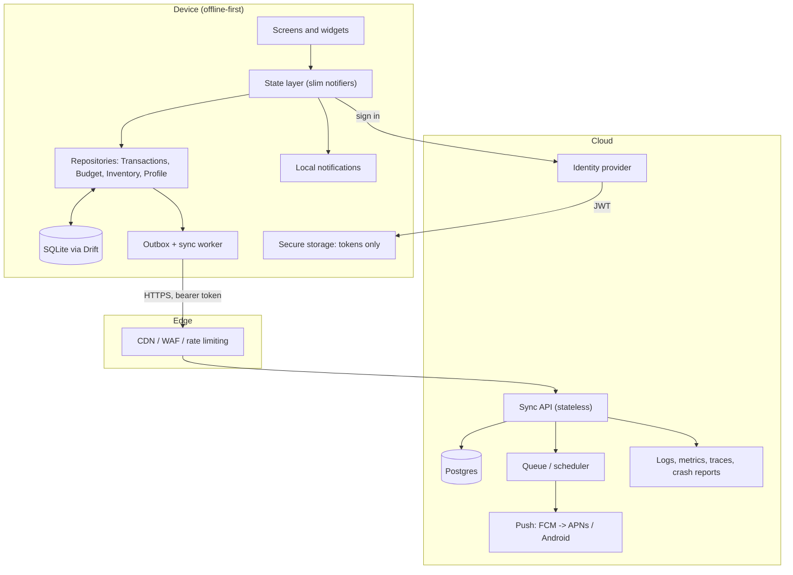

# Spendly production playbook

A handoff document for an AI model (or engineer) picking up Spendly to take it
from a local-only app to a shipped, scalable product on iOS and Android.

It covers: where the code stands, the target cloud architecture on Google
Cloud and on AWS, security, speed, store deployment for both platforms, and an
ordered plan with acceptance criteria. `SCALING.md` is the short version of the
architecture argument; this file is the operational one. Where they differ,
this file is newer.

Snapshot date: 2026-11-16. Branch: `fix/data-integrity-and-polish`, with
uncommitted work at the time of writing.

---

## 0. How to use this document

Rules for the model working from this file:

1. **Verify before you rely on it.** Section 1 describes the repo on the
   snapshot date. Run `git status`, `git log --oneline -5`, `flutter analyze`
   and `flutter test` first and trust what they say over this file.
2. **Things that change outside the repo are marked "verify".** Store policies,
   required API levels, pricing and SDK versions move every year. Look them up
   before acting on them; do not quote them from here as fact.
3. **Do the phases in order** (section 9). Each has acceptance criteria. Do
   not start cloud work before the local database and repository layer exist:
   every later phase depends on that seam.
4. **Ask the owner before anything that costs money, creates accounts, or is
   public**: cloud projects, developer program enrolment, store listings,
   signing keys, releases. Never invent or commit secrets.
5. **Keep the app working offline at every step.** That is the product's main
   quality today and the constraint the architecture is built around.
6. **Keep the test suite green.** 186 tests on the snapshot date. Add tests
   with each phase; do not delete tests to make a change pass.

Environment notes from the machine this was written on: Windows 11, Flutter
3.41.9 stable, no Python installed, no Mac available. iOS builds need macOS
(section 8).

---

## 1. Current state

### What the app does

- Percentage budgets over monthly income, up to 8 categories, with presets.
- Fast expense entry sheet with a keypad, category and subcategory pickers.
- Keyword auto-categorization that learns from the user's own history.
- Budget health per category; savings-type categories are goals, not caps.
- Insights (donut and breakdown), CSV export, multi-currency display.
- **Home inventory**: items with type, quantity, unit, and one date (expiry,
  service due, or reminder). After a purchase that looks like a physical item,
  the app offers to add it now, remind later, or skip.
- **Four themes**: Paper (default), Midnight (dark), Sage, Ocean.

### Architecture today

```
UI (screens, widgets)
   | context.watch / context.read
AppState (ChangeNotifier)        ThemeController (ChangeNotifier)
   | _save() queued, write-through     | 'themeId'
SharedPreferences (JSON strings on the device)
```

- One process, one device, no network calls except `google_fonts` fetching
  font files at runtime.
- Sign-in is a **mock**: any email and any password work, nothing is checked.
- Every save rewrites every key. Fine for hundreds of transactions; it is the
  first thing that degrades with heavy use.

### Code map

| Path | Role |
|---|---|
| `lib/main.dart` | Loads theme, locks portrait, provides `AppState` and `ThemeController` |
| `lib/app.dart` | `MaterialApp`, `buildThemeData`, `ThemeRebuilder`, `_LaunchGate` (picks sign-in, setup, or main after load) |
| `lib/state/app_state.dart` | All app state and persistence. The file to split up in phase 2 |
| `lib/state/theme_controller.dart` | Selected theme, saved under `themeId` |
| `lib/models/` | `TransactionModel`, `CategoryModel`, `InventoryItem`, `PendingInventory` |
| `lib/core/` | Pure logic and design tokens: `categorizer`, `budget_status`, `inventory_rules`, `money`, `csv_exporter`, `currencies`, `app_theme`, `colors`, `text_styles`, `constants` |
| `lib/screens/` | `signin`, `setup` (onboarding and settings), `main_shell` (4 tabs and FAB), `home`, `activity`, `insights`, `inventory` |
| `lib/widgets/` | `add_transaction_sheet`, `inventory_item_sheet`, `inventory_prompt`, `filter_chip` |
| `test/` | `widget_test.dart` (state and logic, despite the name), `fixes_test.dart`, `inventory_test.dart`, `theme_test.dart` |

### Stored keys (SharedPreferences)

`signedIn`, `setupDone`, `demoTxIds`, `inventory`, `pendingInventory`,
`income`, `categories`, `transactions`, `customSubcategories`,
`customSubcatEmojis`, `userName`, `userEmail`, `userCurrency`, `paySchedule`,
`cycleStart`, `themeId`, plus `corruptBackup_<key>` when a value could not be
parsed. Any migration to a database must read all of these once and must not
delete them until the import is confirmed.

### Invariants to preserve

- **Ids are UUID strings** generated on the device. Keep that: it is what
  makes offline creation and later sync possible.
- **A transaction may point at a category that no longer exists.** The UI
  shows it as "Uncategorized" (`AppState.uncategorizedId`). Do not add a
  foreign-key constraint that deletes or rejects such rows.
- **Category colours are saved user data**, so they are constants and do not
  change with the theme. Themed tokens are getters on `AppColors.current`.
- **Savings is an explicit flag** (`CategoryModel.isSavings`); the name is
  only used to pick a default.
- **The "month" period is the budget cycle**, starting on `cycleStartDay`
  (1 or 15), not the calendar month.
- **Saves are serialized** behind `AppState.ready` and coalesced. Do not
  reintroduce unawaited parallel writes.
- **Amounts are `double`.** Move to integer minor units (cents, paise) when
  the database is introduced; see section 3.
- **`MoneyFormat`** (`lib/core/money.dart`) is the only amount formatter.

### Known gaps on the snapshot date

| Gap | Detail |
|---|---|
| iOS project is missing | `ios/` contains only generated files. There is no `Runner.xcodeproj` or `Info.plist`. It must be regenerated (section 8) |
| Android is not release-ready | `applicationId` and namespace are `com.example.spendly`, release is signed with the debug key, label is lowercase `spendly`, default launcher icon |
| No real authentication | Mock sign-in; "Continue with Apple/Google" buttons do nothing real |
| No backup or sync | Uninstalling deletes everything |
| Reminders are in-app only | Inventory dates show a badge and a Home notice. No OS notification is scheduled |
| Fonts load from the network | First launch offline falls back to system fonts |
| Not verified on screen | Inventory purchase prompt, item form, and the Midnight, Sage and Ocean themes pass tests but were not visually checked |
| No CI | Nothing runs analyze or tests on push |
| Dependencies behind | Notably `fl_chart`, `intl`, `google_fonts` |
| Stray file | `lib/screens/assets.code-workspace` points outside the repo |
| Lists are not virtualized | Activity and Inventory build every row up front |

---

## 2. Target architecture

Principle: **the device stays the source of truth for reads; the cloud is a
replica that makes data durable and shared across devices.** The UI never
waits on the network.



### Two reference stacks

Both implement the same diagram. Pick one; do not mix clouds without a reason.

| Concern | Google Cloud / Firebase | AWS |
|---|---|---|
| Identity | Firebase Authentication (email, Google, Apple) | Amazon Cognito user pools (email, Google, Apple) |
| API | Cloud Run (container, scales to zero) | API Gateway + Lambda, or ECS Fargate behind an ALB |
| Database | Cloud SQL for PostgreSQL | Aurora PostgreSQL Serverless v2, or RDS PostgreSQL |
| Document alternative | Firestore (has built-in offline sync) | DynamoDB (via AppSync/Amplify DataStore) |
| Push | Firebase Cloud Messaging (also delivers to iOS through APNs) | SNS mobile push, or still FCM |
| Scheduled jobs | Cloud Scheduler + Cloud Tasks | EventBridge Scheduler + SQS |
| Secrets | Secret Manager | Secrets Manager / SSM Parameter Store |
| Edge | Cloud Armor + Cloud CDN | AWS WAF + CloudFront |
| Files (exports, receipts) | Cloud Storage, signed URLs | S3, pre-signed URLs |
| Crash and analytics | Crashlytics, Analytics | Sentry or Crashlytics; Pinpoint/CloudWatch RUM |
| Observability | Cloud Logging, Monitoring, Trace | CloudWatch, X-Ray |
| Infrastructure as code | Terraform | Terraform or CDK |

### Recommendation

**Start on Firebase Auth + Cloud Run + Cloud SQL (Postgres), with FCM for
push.** Reasons, specific to this app:

- Flutter's first-party SDKs for auth, push and crash reporting are Firebase's,
  and FCM is the usual way to reach both platforms from one API. Using it does
  not tie the database to Google.
- The data is relational and per-user (transactions belong to categories,
  inventory items link to transactions). Postgres with row-level security fits
  better than a document store, and it keeps the option of moving clouds.
- Cloud Run scales to zero, so an app with few users costs very little.

Choose **AWS** instead if the owner already has AWS accounts, credits, or
compliance tooling there. The equivalent is Cognito + API Gateway/Lambda +
Aurora Serverless v2. Expect more setup for mobile auth and push.

The **fastest** route, if speed to market matters more than control, is a
managed backend (Supabase, or Firestore with its built-in offline cache). The
repository seam from phase 2 makes any of these swappable later.

### Data model (cloud)

All tables carry the same sync columns.

```sql
-- Common to every synced table
id          uuid primary key,          -- generated on the device
user_id     uuid not null,             -- from the verified token, never the body
updated_at  timestamptz not null,      -- set by the SERVER on write
deleted_at  timestamptz,               -- soft delete (tombstone)
version     bigint not null default 1  -- incremented by the server

categories   (name, pct, color, is_savings, sort_order)
transactions (amount_minor bigint, currency char(3), category_id uuid,
              label, subcategory, occurred_at timestamptz)
inventory_items (name, kind, quantity numeric, unit, due_type, due_date date,
                 note, transaction_id uuid)
profiles     (display_name, currency, income_minor, cycle_start_day, theme_id)
```

- `category_id` and `transaction_id` are **not** enforced foreign keys with
  cascade. See the invariants in section 1.
- Index `(user_id, updated_at)` on every table for delta pulls, and
  `(user_id, occurred_at desc)` on transactions.
- Enable row-level security with `user_id = current user` on every table, even
  though the API also filters. Two independent checks.

### Sync protocol

Keep it simple. One user, a couple of devices: last-write-wins per row is
enough.

1. **Write**: the repository writes to SQLite and appends the change to an
   `outbox` table in the same local transaction.
2. **Push**: the worker sends outbox rows in batches to
   `POST /v1/sync/push`. Each row has a client-generated mutation id so retries
   are idempotent. The server stamps `updated_at` and `version`.
3. **Pull**: `GET /v1/sync/pull?since=<cursor>` returns rows changed after the
   cursor, including tombstones, paginated. The client applies them and stores
   the new cursor.
4. **Conflicts**: the row with the later server `updated_at` wins. Never use
   device clocks for ordering.
5. **Triggers**: on app start, on resume, after a local write (debounced a few
   seconds), and on a silent push hint from the server.
6. **Deletes** are tombstones. Purge them server-side after 90 days.

---

## 3. Local data layer (do this first)

Replace SharedPreferences for app data with SQLite through **Drift**. This is
worth doing even if the cloud never happens.

- Tables mirror section 2, plus `outbox` and `sync_state`.
- **Money as integer minor units.** Convert on import with
  `(amount * 100).round()`. Zero-decimal currencies (JPY, KRW) need a per-
  currency exponent; store it in the currency catalog.
- **Import once** from the SharedPreferences keys in section 1, inside one
  database transaction, then set a `migratedToDb` flag. Leave the old keys in
  place for at least one release as a fallback.
- Introduce repositories (`TransactionRepository`, `BudgetRepository`,
  `InventoryRepository`, `ProfileRepository`) as interfaces with a Drift
  implementation. `AppState` calls repositories, never storage.
- Split `AppState` along the same lines once repositories exist. It is about
  900 lines and holds budget, transactions, inventory, the draft, and UI
  state.
- Keep SharedPreferences only for small device preferences such as `themeId`.

---

## 4. Security

### Threat model

| Asset | Threat | Control |
|---|---|---|
| A user's financial records | Another user reads them | Server derives `user_id` from the verified token only; row-level security; tests that user A cannot read user B |
| Account | Credential stuffing, weak passwords | Use the identity provider (never store passwords yourself); offer Apple/Google sign-in; rate-limit; optional MFA |
| Session tokens on device | Extraction from backups or a rooted phone | `flutter_secure_storage` (Keychain / Keystore). Never SharedPreferences |
| Data in transit | Interception | TLS 1.2+ only, HSTS at the edge, no cleartext traffic allowed in the Android manifest or iOS ATS exceptions |
| Local database | Lost or stolen phone | Rely on OS full-disk encryption first. Add SQLCipher only if the owner wants app-level encryption, since it costs performance |
| API | Abuse, scraping, cost blow-up | WAF, per-user and per-IP rate limits, request size limits, pagination caps |
| Secrets | Leaked keys in the repo or the app binary | Server secrets in a secret manager. Nothing secret ships in the app: assume the binary is public |
| Supply chain | Malicious or vulnerable package | Pin versions, commit `pubspec.lock`, enable Dependabot or `osv-scanner` in CI |
| Logs and analytics | Leaking amounts, labels, emails | Log ids and counts only. No transaction labels or amounts in logs or analytics events |

### Authentication and authorization

- Replace `AppState.signIn` with the identity provider SDK. The existing
  screens can stay.
- **Apple rule (verify current wording):** if the app offers third-party
  sign-in such as Google, App Review generally requires an equivalent privacy-
  preserving option; Sign in with Apple satisfies it. Plan to ship both.
- Short-lived access token, refresh token in secure storage. The API verifies
  the signature, issuer, audience and expiry on every request.
- Authorization is by `user_id` from the token. Reject any request body that
  carries a different one.

### Privacy and compliance

- **Account and data deletion are required** by both stores when accounts
  exist: an in-app path on iOS, and an in-app path plus a web link for Google
  Play (verify current policy text). Implement a real delete: mark the user,
  purge rows and backups on a schedule.
- Provide a data export. The CSV exporter is a start; add inventory.
- Publish a privacy policy URL. Fill in Apple's privacy "nutrition label" and
  Google Play's Data Safety form truthfully; both ask what is collected, why,
  and whether it is linked to the user.
- iOS needs a **privacy manifest** (`PrivacyInfo.xcprivacy`) declaring
  required-reason API use; several Flutter plugins ship their own (verify).
- Applicable law depends on where users are: GDPR (EU/UK), India's DPDP Act,
  CCPA (California). Common ground: collect the minimum, state the purpose,
  honour deletion and export, keep data in a declared region.
- This app does not connect to banks or move money, so PCI DSS does not
  apply. That changes if bank linking or payments are added.

### App hardening

- Build releases with `--obfuscate --split-debug-info=<dir>` and keep the
  symbol files for crash reports.
- Android: set `android:allowBackup="false"` or define backup rules that
  exclude the database and tokens; no `usesCleartextTraffic`.
- Optional app lock with biometrics (`local_auth`) for a finance app. Good
  feature, not a substitute for the above.
- Certificate pinning is optional. It adds an operational risk (a bad pin
  rotation locks every user out); only add it with a rotation plan.

---

## 5. Speed

### Targets

| Metric | Target |
|---|---|
| Cold start to first usable frame | under 2 s on a mid-range Android phone |
| Saving a transaction | under 100 ms, perceived as instant, never waits on network |
| Scrolling | 60 fps with 10,000 transactions |
| API p95 latency for sync calls | under 300 ms in the user's region |
| Release app size | under 30 MB download |

### Client

- **Database, not JSON blobs.** Today each save re-encodes every transaction.
  SQLite with indexes makes a save constant-time.
- **Query for what is shown.** `AppState.filtered` scans all transactions on
  every rebuild and `monthSpentForCat` is called several times per category
  per frame. Replace with indexed SQL aggregates
  (`SUM ... GROUP BY category_id`) exposed as streams.
- **Virtualize long lists.** Activity builds every day group with
  `SliverChildListDelegate`; Inventory builds every row in one `Column`. Use
  `SliverList.builder` with paging.
- **Narrow rebuilds.** Almost every widget calls `context.watch<AppState>()`,
  so any change rebuilds everything. Use `context.select` or split the
  notifier (section 3).
- **Bundle the fonts** as assets and set
  `GoogleFonts.config.allowRuntimeFetching = false`. Removes a network
  dependency at startup and a layout shift.
- Run CSV export and any import in an isolate (`compute`).
- Measure with `flutter run --profile` and DevTools before and after. Do not
  optimize without a trace.

### Backend

- Put the API and database in **one region close to the users**. For users in
  India that is Mumbai (`asia-south1` on Google, `ap-south-1` on AWS).
- **Connection pooling** in front of Postgres (PgBouncer, Cloud SQL
  connector pooling, or RDS Proxy). Serverless instances otherwise exhaust
  connections.
- Delta sync with a cursor and gzip, never full downloads after the first.
- Batch pushes (up to a few hundred rows per request).
- Keep at least one warm instance once there are real users, to avoid cold
  starts on the first sync after opening the app.
- Add read replicas and caching only when metrics show the need. At this
  data shape one modest Postgres instance handles tens of thousands of users.

---

## 6. Reminders and notifications

The inventory feature needs this before it is useful in daily life.

1. **Local notifications first** (`flutter_local_notifications`). When an
   item with a date is saved, schedule a notification for the morning of the
   due date and one a few days before. Cancel and reschedule on edit or
   delete. Works offline, needs no backend. Requires the notification
   permission prompt on iOS and on Android 13+, and exact-alarm handling on
   Android (verify current rules).
2. **Push later**, once sync exists, for cross-device consistency: a
   scheduled job finds due items and sends through FCM. iOS needs an APNs key
   uploaded to Firebase and the Push Notifications capability.
3. Ask for notification permission at the moment the user adds their first
   dated item, not at launch.

---

## 7. Deploying to Android (Google Play)

Prerequisites: a Google Play Console developer account (one-time fee; verify
amount), a privacy policy URL, and app icons.

1. **Identity.** Choose a permanent application id, for example
   `com.<owner>.spendly`. Change `applicationId` and `namespace` in
   `android/app/build.gradle.kts`, move
   `android/app/src/main/kotlin/com/example/spendly/MainActivity.kt` to the
   matching package path, and set `android:label="Spendly"` in the manifest.
   The id can never change after the first upload.
2. **Signing.** Create an upload keystore with `keytool`, keep it and its
   passwords outside the repo, reference them through
   `android/key.properties` (already git-ignored in `android/.gitignore`,
   along with `*.jks` and `*.keystore`), and replace the debug `signingConfig` in the `release` build
   type. Enrol in Play App Signing so Google holds the app signing key and a
   lost upload key is recoverable.
3. **Icons and splash.** Replace the default launcher icon
   (`flutter_launcher_icons`) and add a splash (`flutter_native_splash`).
4. **Versioning.** `version: x.y.z+N` in `pubspec.yaml`; `N` must increase
   with every upload.
5. **Build.**
   ```bash
   flutter build appbundle --release --obfuscate --split-debug-info=build/symbols
   ```
6. **Target API level.** Play requires recent target SDK levels and raises
   the bar yearly. Check the current requirement and the Flutter version's
   default before building.
7. **Console.** Create the app, complete the store listing, content rating,
   target audience, Data Safety form, and data deletion details.
8. **Testing tracks.** Internal testing first, then closed testing. New
   personal developer accounts must run a closed test with a minimum number of
   testers for a set period before production access (verify current
   numbers).
9. **Release.** Staged rollout (for example 10%, 50%, 100%) and watch crash
   and ANR rates in Android vitals.

## 8. Deploying to iOS (App Store)

Prerequisites: a **Mac with Xcode**, an Apple Developer Program membership
(annual fee; verify amount), and a privacy policy URL. This cannot be done
from the Windows machine. Options: a Mac, or a hosted macOS CI runner
(GitHub Actions macOS runners, Codemagic, Xcode Cloud).

1. **Regenerate the iOS project.** It is missing from the repo. On a Mac, in
   the repo root:
   ```bash
   flutter create --platforms=ios --org com.<owner> .
   ```
   This adds `ios/Runner.xcodeproj`, `Info.plist` and the rest without
   touching `lib/`. Review the diff and commit it.
2. **Identity.** Bundle identifier in Xcode matching the id registered in the
   Apple Developer portal, display name "Spendly", deployment target as the
   current Flutter minimum.
3. **Signing.** Automatic signing with the team selected is simplest. For CI
   use an App Store Connect API key and `fastlane match` or Xcode Cloud.
4. **Capabilities.** Push Notifications and Background Modes (remote
   notifications) when push is added; Sign in with Apple when auth is added.
5. **Info.plist.** Portrait only (the app locks portrait in `main.dart`),
   usage description strings for any permission requested, and export
   compliance: the app uses only standard HTTPS encryption, so set
   `ITSAppUsesNonExemptEncryption` to `false` (confirm this stays true).
6. **Privacy manifest** and privacy labels (section 4).
7. **Build and upload.**
   ```bash
   flutter build ipa --release --obfuscate --split-debug-info=build/symbols
   ```
   Upload with Xcode Organizer, Transporter, or `fastlane pilot`.
8. **TestFlight.** Internal testers immediately; external testers after a
   short beta review.
9. **App Review.** Provide a demo account in the review notes once real auth
   exists. Common rejection causes for an app like this: sign-in buttons that
   do nothing (true today), missing account deletion, missing Sign in with
   Apple, placeholder content. Fix the mock sign-in before submitting.
10. **Release.** Phased release over 7 days.

### Both stores

- Screenshots for the required device sizes, an icon, a short and a long
  description, support URL, privacy policy URL.
- Remove or clearly gate the demo data before release so reviewers and users
  do not mistake it for real data. The "Remove sample transactions" control
  exists already.

---

## 9. Plan, in order

| # | Phase | Done when |
|---|---|---|
| 0 | **Stabilize.** Commit current work. Check inventory flows and all four themes on screen. Delete the stray workspace file. Add CI (analyze + test on push). Update dependencies | CI green on `main`; every screen reviewed in each theme |
| 1 | **Local database.** Drift schema, one-time import from SharedPreferences, integer money | Existing tests pass against the database; a device with old data upgrades without loss; 10,000 transactions scroll smoothly |
| 2 | **Repositories and state split.** Interfaces between state and storage; break up `AppState` | No widget or notifier imports storage; aggregates come from SQL |
| 3 | **Local notifications** for inventory dates | A dated item produces a notification on the day with the app closed, on both platforms; edits reschedule |
| 4 | **Store readiness.** App id, signing, icons, bundled fonts, iOS project regenerated, privacy policy | Signed release builds install from internal testing on Android and TestFlight on iOS |
| 5 | **Real authentication.** Identity provider, Apple and Google sign-in, secure token storage, account deletion | Mock sign-in removed; wrong password is rejected; deleting an account removes its data |
| 6 | **Backend.** Infrastructure as code, Postgres schema with row-level security, sync API, staging and production environments | API integration tests pass, including "user A cannot read user B" |
| 7 | **Sync.** Outbox, push, pull, conflict rule, tombstones | Two devices converge after offline edits on both; airplane-mode use is unaffected |
| 8 | **Operate.** Crash reporting, dashboards, alerts, backups with a tested restore, runbook | A restore from backup has been performed once; alerts fire in a drill |
| 9 | **Public release.** Staged rollout on both stores | Crash-free sessions above 99.5% during rollout |

Phases 0 to 4 need no cloud account and produce a shippable local-only app.
That is a legitimate first release: honest about being on-device, with no
fake sign-in.

---

## 10. CI/CD and environments

- **CI on every push** (GitHub Actions): `flutter analyze`, `flutter test`,
  and a debug build for Android. Add a macOS job for iOS once the project
  exists.
- **Release pipelines**: tag-triggered. Android builds the bundle and uploads
  to the internal track; iOS builds the IPA and uploads to TestFlight.
  `fastlane` handles both.
- **Secrets** live in the CI secret store: keystore (base64), keystore
  passwords, Play service account JSON, App Store Connect API key. Never in
  the repo.
- **Environments**: `dev`, `staging`, `prod` as separate cloud projects or
  accounts with separate databases. Use Flutter flavors or
  `--dart-define-from-file` for the API base URL and Firebase config.
- **Database migrations** run in the pipeline before the API deploy and must
  be backward compatible with the previous app version, because users update
  slowly.
- **API versioning**: prefix routes with `/v1`. Old app versions stay in use
  for months; keep a minimum-supported-version check the server can raise.

---

## 11. Observability and operations

- **Client**: Crashlytics or Sentry, with symbol upload from the
  `--split-debug-info` directory. Track crash-free sessions, startup time,
  and sync failures. No financial content in events.
- **Server**: structured JSON logs with a request id, user id (not email),
  route, status and duration. Metrics for request rate, error rate, latency
  percentiles, database connections, queue depth.
- **Alerts**: 5xx rate, p95 latency, database CPU and storage, failed
  backups, push delivery failures.
- **Backups**: automated daily snapshots plus point-in-time recovery on
  Postgres. Practise a restore; an untested backup is not a backup.
- **Targets**: 99.9% API availability is ample, because the app works
  offline and a sync outage delays replication without blocking use.

---

## 12. Scale and cost guide

Rough orders of magnitude to check against current pricing, not quotes.

| Users (monthly active) | Shape | Notes |
|---|---|---|
| 0 to 1,000 | Managed auth, one small Postgres, one serverless API service | Mostly within free or minimum tiers. Database is the main fixed cost |
| 1,000 to 50,000 | Same shape, larger database, connection pooler, minimum one warm API instance | Add staging. Watch egress and push volume |
| 50,000 to 500,000 | Read replica, background workers for push and exports, CDN in front | Partition or archive old transactions if tables grow large |
| Above 500,000 | Multi-region reads, dedicated on-call, possibly sharding by user | Only with evidence from metrics |

Each user generates little data: on the order of a few transactions a day.
Load is dominated by sync calls on app open, so plan for a morning and evening
peak in the main time zone.

---

## 13. Testing strategy

| Layer | What | Tooling |
|---|---|---|
| Unit | Models, rules, formatting, state (exists: 186 tests) | `flutter test` |
| Database | Migrations from each previous schema version, import from SharedPreferences | Drift schema tests, in-memory SQLite |
| Widget | Sheets, pickers, theme switching, small-screen layouts | `flutter_test`. Note: `google_fonts` cannot fetch in tests; inject the font family |
| Golden | Each screen in each of the four themes | `golden_toolkit` or built-in goldens |
| Integration | Add spending, add inventory item, sign in, sync | `integration_test` on emulators in CI |
| API | Auth required, isolation between users, idempotent push, pagination | The backend's test framework against a disposable Postgres |
| Sync | Two simulated clients with offline edits converge | Property-style tests over the sync protocol |

A regression worth a permanent test: the transaction sheet must show the
category picker on short and wide screens. The keypad once grew to fill the
sheet and hid it.

---

## 14. Decisions the owner must make

Do not guess these; ask.

1. Cloud: Google, AWS, or a managed backend.
2. Launch scope: local-only first (phases 0 to 4), or wait for accounts and
   sync.
3. Application id and bundle id (permanent).
4. Which countries at launch. This sets the region and the privacy rules.
5. Free, paid, or subscription. Subscriptions add store billing and server
   receipt validation, which this document does not cover.
6. Whether to encrypt the local database at the app level.
7. Who holds the signing keys and developer accounts.
