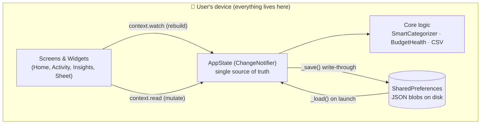
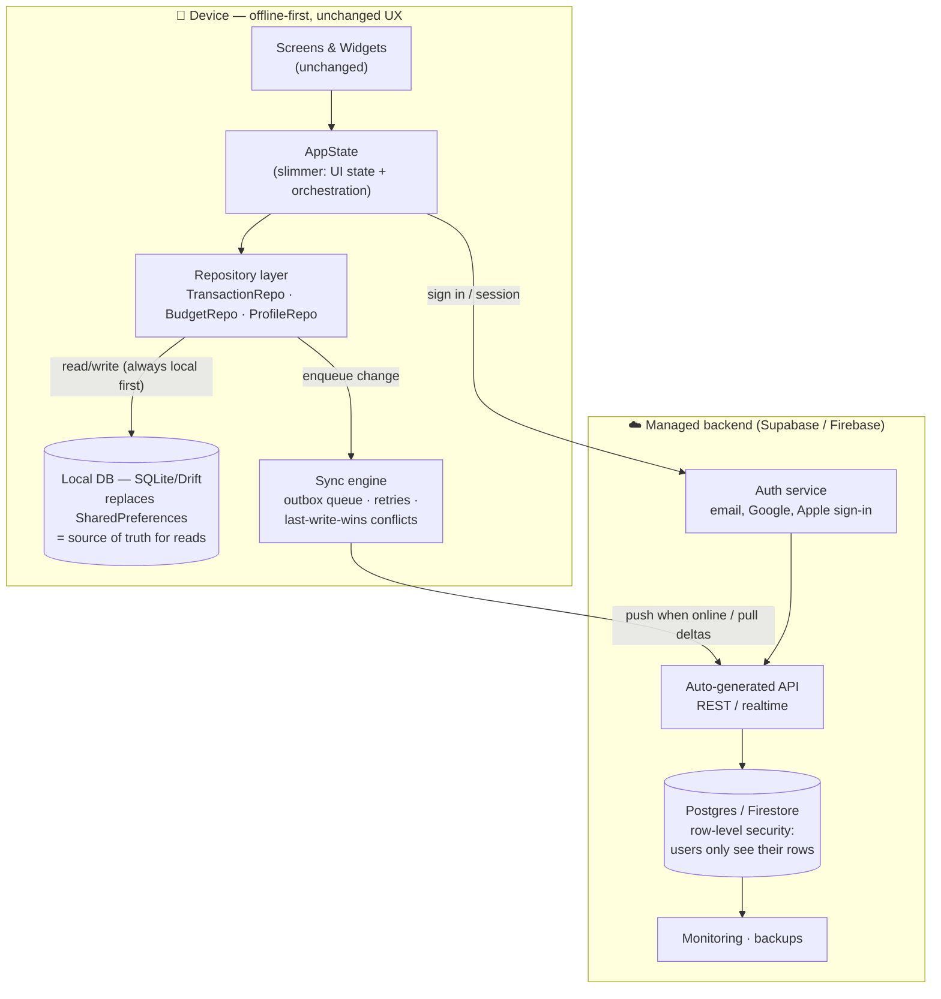
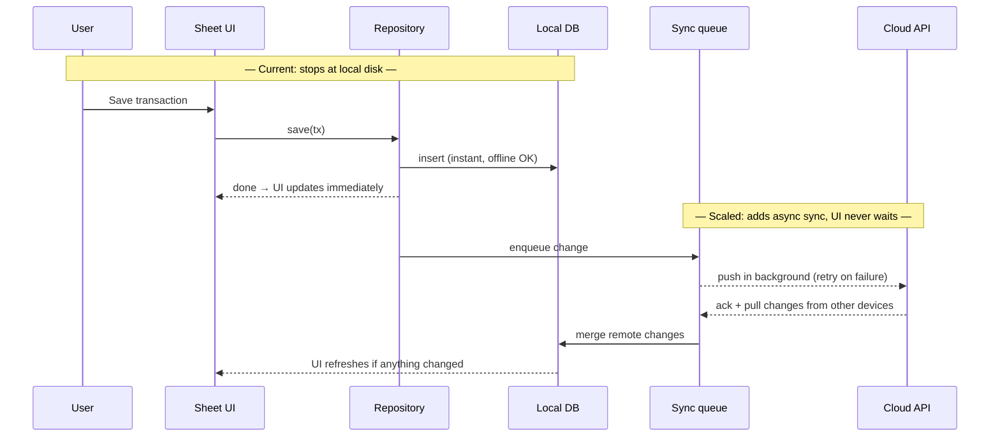

# Scaling Spendly

How to take Spendly from a local-only app to thousands of users — and what
should change (and what shouldn't) along the way.

## The starting insight

Spendly today already "scales" to thousands of users in one sense: **there is
no shared backend**. Every install is self-contained, so users add zero load
on any server. What doesn't scale is the *product experience*:

- No sync across devices
- No backup — uninstalling the app deletes all data
- No real authentication (sign-in is a local mock)
- No analytics or crash visibility

So "scaling" here means **adding a backend without breaking the offline-first
speed the app has now**.

## Current architecture

**Flow:** every mutation goes `UI → AppState → _save() → SharedPreferences →
notifyListeners() → UI rebuilds`. Simple and instant, but single-device and
unrecoverable.

## Target architecture (thousands of users)

At this scale, don't build custom servers — use a managed backend
(Supabase or Firebase). The critical client-side change is inserting a
**repository layer** so `AppState` stops talking to storage directly:

## Write path: current vs scaled

## Migration roadmap (in order of effort)

| # | Change | Why |
|---|--------|-----|
| 1 | Replace SharedPreferences with **SQLite (Drift)** | JSON-blob storage rewrites *all* transactions on every save — that degrades at a few thousand transactions, even single-user |
| 2 | Introduce **repositories** between AppState and storage | The seam that lets you add cloud sync later without touching any screen |
| 3 | Add **Supabase/Firebase auth** to replace the mock sign-in | Real accounts; row-level security isolates each user's data |
| 4 | Add the **sync engine** (outbox pattern) | Offline-first is preserved: UI always reads and writes locally, sync runs in the background |
| 5 | Add **analytics + crash reporting** | You can't operate what you can't see |

## Guiding principles

1. **The UI layer needs zero changes.** The repository seam absorbs
   everything — screens keep calling the same `AppState` methods.
2. **Never make the UI wait on the network.** The current app feels instant
   because writes are local; the scaled one must too. Reads come from the
   local DB, sync is asynchronous.
3. **Conflicts stay simple.** For personal-finance data with one user across
   a couple of devices, last-write-wins per record is enough; don't build
   CRDTs for this.
4. **Right-size the infrastructure.** A managed backend's free/starter tier
   comfortably handles thousands of users. Custom infrastructure (your own
   API servers, load balancers, caching tiers) isn't warranted until
   somewhere past ~100k active users.

## Cost of doing nothing

If you never add a backend, the app still works — but every device is an
island, one lost phone means lost data, and the mock sign-in gives a false
sense of an account system. Step 1 (SQLite) is worth doing even standalone,
because SharedPreferences JSON blobs are the one part of the current design
that degrades with heavy single-user use.
